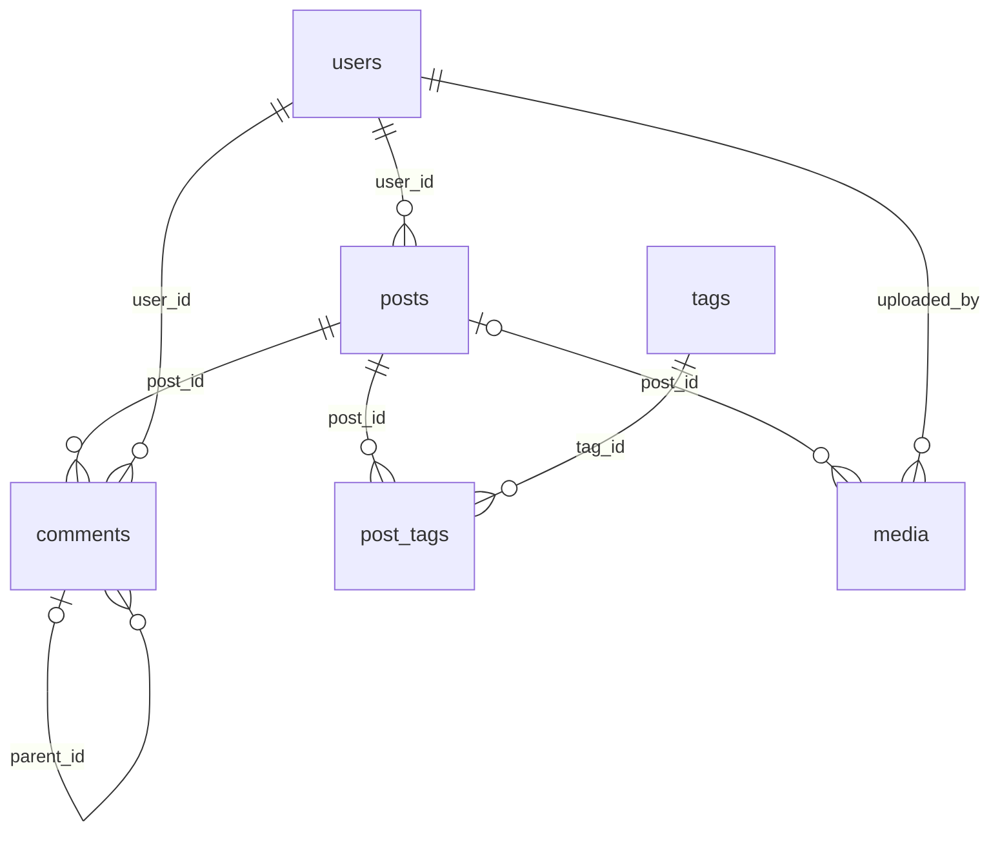

# schemascope

**Point your coding agent at a database. Get a diagram worth sharing, and a ranked list of what is wrong with it — each finding with the DDL that fixes it.**

Your agent just designed your schema. It declared the foreign keys and forgot the indexes, stored timestamps as `TEXT`, put money in a `REAL`, and left `status` as free text that accepts anything. schemascope finds that, explains why each one will hurt, and hands you the migration.



<sub>Rendered by GitHub from the Mermaid that schemascope emitted. No image, no build step.</sub>

```
  SCHEMA AUDIT   examples/blog-schema/before.sql
  7 tables · postgres

  critical    6  ███████
  high       25  ████████████████████████████
  medium      7  ████████
  low        12  █████████████

  50 findings across 7 tables


  CRITICAL  (6)
  ──────────────────────────────────────────────────────────
  posts.user_id
    user_id looks like a reference to users but no foreign key enforces it.
    fk_without_constraint — The database will happily store an id that points
    at nothing. Orphans accumulate silently, deletes leave dangling references,
    and the only thing protecting integrity is application code that every new
    caller has to remember.

      ALTER TABLE posts ADD CONSTRAINT fk_posts_user_id
        FOREIGN KEY (user_id) REFERENCES users (id)
        ON DELETE RESTRICT;
      CREATE INDEX idx_posts_user_id ON posts (user_id);
```

The same model with every finding addressed drops to **0 findings** — the full
before/after is in [`examples/blog-schema/`](examples/blog-schema).

   

---

## Install

Paste this to your agent:

```
Install schemascope for me by reading
https://raw.githubusercontent.com/NHTanvir/schemascope/master/llms.txt
```

Or place it yourself:

```bash
git clone https://github.com/NHTanvir/schemascope ~/.claude/skills/schemascope
```

Claude Code can also add it as a plugin:

```
/plugin marketplace add NHTanvir/schemascope
```

Works in Claude Code, Cursor, Codex, OpenClaw and anything else that reads a
`SKILL.md`. The scripts are plain Python 3.9+ with **no dependencies**, so they
also run on their own without any agent at all.

---

## Use it without an agent

```bash
# audit anything
python3 scripts/audit.py schema.sql
python3 scripts/audit.py schema.prisma
python3 scripts/audit.py app.sqlite

# a live Postgres or MySQL database, with no driver installed
pg_dump --schema-only mydb        | python3 scripts/audit.py -
mysqldump --no-data -u root mydb  | python3 scripts/audit.py -

# other output shapes
python3 scripts/audit.py schema.sql --markdown      # for a PR comment
python3 scripts/audit.py schema.sql --sql           # just the migration
python3 scripts/audit.py schema.sql --json          # for tooling
python3 scripts/audit.py schema.sql --strict        # exit 1 on critical, for CI

# diagrams
python3 scripts/render.py schema.sql --mermaid      # paste into a README
python3 scripts/render.py schema.sql --out=report.html
```

`report.html` is one self-contained file: the diagram, every finding, and the fix
for each, in light and dark. Nothing phones home — no schema ever leaves your machine.

---

## What it finds

24 rules. Every finding carries the DDL that fixes it, because a finding without
a fix is just a complaint.

### Critical

| Rule | Catches |
|---|---|
| `no_primary_key` | a table whose rows cannot be addressed |
| `fk_without_constraint` | `user_id` with nothing enforcing that a user exists |
| `plaintext_secret` | a `password` or `token` column holding the real thing |

### High

| Rule | Catches |
|---|---|
| `unindexed_fk` | the single most common defect in generated schemas |
| `no_cascade_rule` | a foreign key that makes deletes fail instead of doing something defined |
| `boolean_as_text` | `is_active TEXT DEFAULT 'true'` |
| `timestamp_as_text` | dates that sort alphabetically |
| `numeric_as_text` | `view_count TEXT`, where `'10' < '9'` |
| `money_as_float` | totals that stop reconciling |
| `missing_unique` | `email` and `slug` with no unique constraint |
| `nullable_everything` | a schema that enforces nothing |

### Medium

| Rule | Catches |
|---|---|
| `enum_as_free_text` | `status` accepting any string ever written to it |
| `json_as_text` | structured data that cannot be queried or validated |
| `timestamp_without_timezone` | the same column meaning different instants |
| `duplicate_rows_possible` | a join table that lets the same relationship in twice |
| `fk_type_mismatch` | `smallint` pointing at a `bigint` key |
| `missing_timestamps` | no `created_at`, unrecoverable after the fact |
| `unbounded_text` | a megabyte written into an email field |

### Low

`no_updated_at` · `inconsistent_naming` · `reserved_word_column` · `redundant_index` · `wide_table`

Each rule is documented with its rationale in
[`references/audit-rules.md`](references/audit-rules.md).

---

## Inputs

| Source | How |
|---|---|
| PostgreSQL | `pg_dump --schema-only` |
| MySQL / MariaDB | `mysqldump --no-data` |
| SQLite | read the file directly |
| Prisma | `schema.prisma` parsed natively |
| Raw DDL | any `.sql` migration or schema file |

No database drivers are required for any of them. Dump output and schema files
cover every stack with nothing to install, which is the entire point.

---

## Why not an existing tool

| Tool | Why it does not do this |
|---|---|
| drawDB | you draw the diagram by hand |
| SchemaSpy | needs Java and Graphviz; produces docs, not a prioritised review |
| DBeaver | a desktop GUI; your agent cannot use it |
| Atlas | migrations, not review or diagrams |
| prisma-erd-generator | diagram only, Prisma only |

All of them are good. None of them is something your coding agent can run in one
line to tell you what it just got wrong.

---

## How it works

```
introspect.py   DDL / Prisma / SQLite  ->  one normalized JSON shape
audit.py        that JSON              ->  ranked findings + fix DDL
render.py       that JSON              ->  Mermaid + standalone HTML
```

Three small files, one data format between them, no dependencies. Adding a rule
means adding one function in `audit.py`; adding an input means one parser in
`introspect.py`.

```bash
python3 -m unittest discover -s tests   # 44 tests, stdlib only
```

## Related

Two more tools in the same family — an agent skill, no dependencies, an audit
that draws what it found:

- **[statescope](https://github.com/NHTanvir/statescope)** — the state machine
  your code *actually* implements, drawn, with every illegal path cited to the
  line that allows it. Where this tool reports `enum_as_free_text`, that one
  reads the code writing to the column and finds the paths nobody meant to
  allow: `refunded -> pending`, writes with no guard, transitions that run
  backwards.
- **[gatescope](https://github.com/NHTanvir/gatescope)** — every route resolved
  to the guards that actually protect it, printed as a route-by-role matrix, so
  the endpoint nothing is guarding is visible at a glance.

## Contributing

New rules are the most useful contribution: open an issue with the schema that
should have been flagged. See [CONTRIBUTING.md](CONTRIBUTING.md).

## License

MIT
